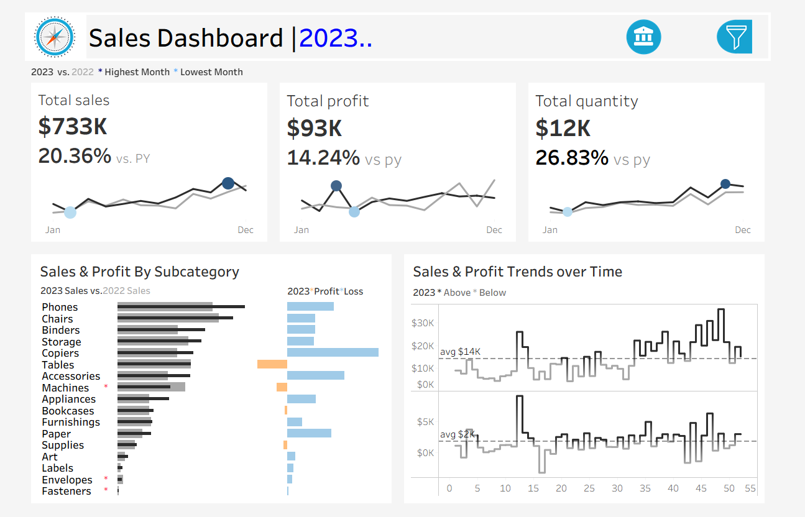
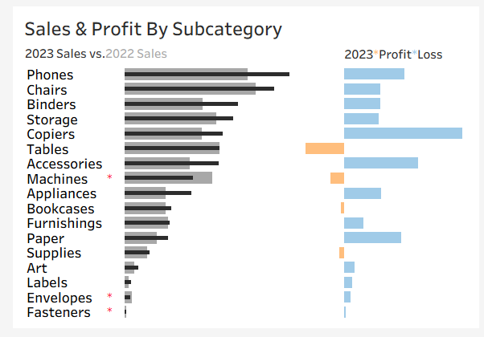
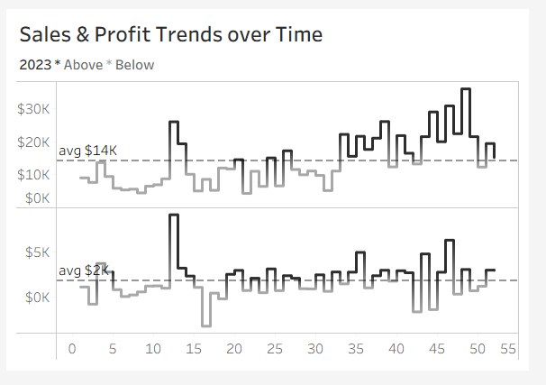

# Sales Dashboard (Tableau)

Interactive Tableau dashboard comparing sales, profit and quantity year over year (2021-2023).

🔗 **[Explore the live dashboard on Tableau Public](https://public.tableau.com/app/profile/suhas.mr/viz/sales_Dashboard_17955036425610/SalesDashboard)**: use the year filter to check each answer below.

## Purpose
Present an overview of sales metrics and trends to analyze year-over-year performance.

## Business Questions & Insights

### 1. Has growth been steady?
**Answer:** No. Sales fell 2.8% in 2021, jumped 29.5% in 2022, then grew 20.4% in 2023.

**Recommendation:** Investigate what drove 2022 and why growth slowed in 2023.

### 2. Does the seasonal pattern repeat?
**Answer:** Yes. Sales are lowest in January and peak near year-end in all three years.

**Recommendation:** Plan inventory and promotions for Q4 and expect a slow January.

### 3. Are the same subcategories losing money every year?
**Answer:** Tables is loss-making in all three years. Bookcases (2021), Machines (2023) and Supplies lost money in some years.

**Recommendation:** Review pricing and discounts on Tables first.

### 4. Did profit growth lag sales growth every year?
**Answer:** No, only in 2023 (profit +14.2% vs sales +20.4%).

**Recommendation:** Check what changed in 2023, such as discounts, costs or product mix.

### 5. Was the week 14 spike a one-time event?
**Answer:** No. A spike around weeks 13-15 appears every year.

**Recommendation:** Find out what drives it (for example quarter-end orders) and plan for it.

*2023 shown. Use the year filter on Tableau Public to compare other years.*

## Dashboard Features
- KPI cards: sales, profit and quantity vs previous year
- Monthly trend lines with highest and lowest months highlighted
- Sales vs profit by subcategory, with losses in orange
- Weekly sales and profit with average lines
- Filters for year, category, sub-category, region, state and city.

## Dataset
Dataset from the "Code with Bara" YouTube tutorial: https://youtu.be/dahrmqT5GD4?si=mvB1UxpEt4vobX9R
Orders from 2020 to 2023 across four tables, joined in Tableau.

| Table | Description |
|---|---|
| Orders | Order-level sales, profit, quantity and dates |
| Customers | Customer details |
| Products | Category and sub-category |
| Location | Region, state and city |

## About this project
Dashboard built by following the tutorial. The business questions, answers and recommendations above are my own analysis of the dashboard.

## Tools
Tableau Public

## Note
The quantity KPI card displays a "$" by mistake. The values are unit counts.
